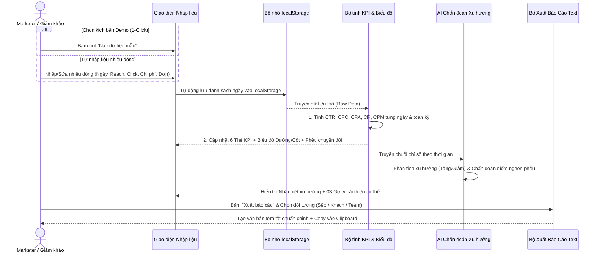

# BƯỚC 2: KẾ HOẠCH CHIẾN LƯỢC TỔNG THỂ (STRATEGIC PLAN)
**Dự án:** AdPulse Mini — Dashboard KPI Chiến Dịch Quảng Cáo Tự Động (Đề 7)

---

## 1. Giải thích & Quyết định cơ chế Nhập liệu (Trả lời câu số 3)

Để một Marketer **"không rành Excel"** dùng thấy sướng nhất và **Ban Giám Khảo (BGK)** chấm điểm cao nhất, chúng ta sẽ kết hợp 2 cơ chế sau:

> [!TIP]
> **Chiến lược "Chiều lòng Giám khảo & Marketer":**
> 1. **Nút "Dữ liệu mẫu 1-Click" (Dành cho Giám khảo):** Khi BGK mở web lên chấm bài, họ rất ngại phải tự nghĩ số và gõ từng dòng. Chúng ta làm sẵn 3 nút kịch bản (*"Chiến dịch Thắng Lợi"*, *"Chiến dịch Đang Đốt Tiền"*, *"Chiến dịch Bão Hòa"*). BGK chỉ cần bấm 1 cú click là bảng tự điền 7 ngày số liệu, biểu đồ và AI lập tức nhảy số rực rỡ.
> 2. **Bảng nhập nhiều dòng trực tiếp - Multi-row Form (Dành cho Marketer & Đúng chuẩn yêu cầu đề bài):** Thay vì nhập từng ngày rồi bấm Lưu 7 lần, người dùng có một bảng gồm sẵn nhiều dòng. Có nút **"+ Thêm 1 ngày"** hoặc **"+ Tạo nhanh 7 ngày liên tiếp"** (tự động điền sẵn ngày tháng tăng dần), người dùng chỉ việc gõ con số vào các ô `Reach`, `Click`, `Chi phí`, `Đơn hàng` rồi bấm Lưu (hoặc tự động lưu vào `localStorage`).

---

## 2. Cấu trúc Tính năng Chiến lược (Feature Matrix)

### A. Nhóm tính năng Cốt lõi (Đáp ứng 100% tiêu chí BTC)
| STT | Hạng mục đề bài | Giải pháp triển khai trong ứng dụng |
| :--- | :--- | :--- |
| **1** | **Form nhập số liệu theo ngày** (`Reach`, `Click`, `Chi phí`, `Đơn hàng`, nhiều dòng, lưu `localStorage`) | - Bảng nhập liệu nhiều dòng cùng lúc (Multi-row Input) có kiểm tra lỗi thông minh (không cho nhập số âm, cảnh báo nếu `Click > Reach`).<br>- Tự động lưu bền vững vào bộ nhớ trình duyệt (`localStorage`) ngay khi thay đổi, tải lại trang không mất dữ liệu.<br>- Cho phép thêm dòng, xóa dòng, xóa trắng toàn bộ, hoặc nạp nhanh 3 kịch bản dữ liệu mẫu. |
| **2** | **Tự động tính chỉ số: `CTR`, `CPC`, `Chi phí/Đơn hàng`** | - Tự động tính trên từng ngày **VÀ** tính tổng/trung bình toàn chiến dịch trên các thẻ KPI tổng quan (Scorecards).<br>- **Công thức chuẩn:**<br>  • `CTR (%)` = `(Click / Reach) × 100`<br>  • `CPC (VNĐ)` = `Chi phí / Click`<br>  • `CPA - Chi phí/Đơn (VNĐ)` = `Chi phí / Số đơn hàng`<br>- *Xử lý an toàn:* Nếu `Reach = 0`, `Click = 0` hoặc `Đơn hàng = 0` thì hiển thị `0` hoặc `Chưa phát sinh`, tuyệt đối không bị lỗi `NaN` hay `Infinity`. |
| **3** | **Vẽ biểu đồ Đường / Cột theo ngày** | - **Biểu đồ Xu hướng theo ngày (Combo Bar & Line Chart):** Giải quyết bài toán lệch đơn vị giữa `Chi phí` (triệu đồng) và `Đơn hàng` (chục đơn) bằng biểu đồ 2 trục tung (Dual-Axis) + nút chuyển đổi góc nhìn (`Tất cả`, `Chi phí & Đơn hàng`, `Reach & Click`, `Hiệu quả CPC & CPA`). |
| **4** | **AI nhận xét xu hướng & 03 gợi ý cải thiện** | - **Chế độ Hybrid (2 lớp):**<br>  1. **Smart Marketing Engine (Mặc định - Chạy tức thì 0 giây):** Tự động so sánh nửa đầu vs. nửa cuối chiến dịch (hoặc ngày cuối vs. trung bình), chỉ ra xu hướng Tăng/Giảm kèm % biến động, phát hiện ngày "đốt tiền" bất thường và đưa ra **đúng 03 gợi ý cải thiện** theo 3 trụ cột: *Nội dung/Creative (khi CTR thấp)*, *Tối ưu Đấu thầu/Ngân sách (khi CPC/CPM cao)*, và *Landing Page/Chốt đơn (khi CR thấp, CPA cao)*.<br>  2. **Chế độ Gemini AI Chuyên sâu (Tùy chọn):** Nút phân tích nâng cao bằng AI tạo sinh khi người dùng muốn đào sâu thêm. |
| **5** | **Nút xuất báo cáo tóm tắt dạng Text** | - Cửa sổ xem trước bản tin báo cáo (Report Preview) kèm nút **"Copy báo cáo 1-Chạm"**.<br>- Hỗ trợ định dạng sẵn icon, gạch đầu dòng rõ ràng để dán thẳng vào Zalo, Messenger, Slack hoặc Email. |

### B. Nhóm tính năng "Ăn điểm / Wow-Factor" (Tạo sự khác biệt với thí sinh khác)
1. **Chỉ số Mở rộng Tự động (`CR%` & `CPM`):**
   - Không bắt người dùng nhập thêm bất kỳ ô nào, nhưng hệ thống tự động tính thêm **Tỷ lệ chuyển đổi (`CR = Đơn hàng / Click × 100%`)** và **Chi phí mỗi 1.000 lượt tiếp cận (`CPM`)** để Marketer biết chính xác khâu nào đang gặp vấn đề.
2. **Biểu đồ Phễu Chuyển Đổi (Marketing Conversion Funnel):**
   - Trực quan hóa 3 tầng: `Tổng Reach` ➔ `Tổng Click (kèm % CTR)` ➔ `Tổng Đơn hàng (kèm % CR)`. Nhìn vào phễu là biết ngay khách hàng đang "rơi rụng" nhiều nhất ở bước xem quảng cáo hay bước mua hàng.
3. **3 Phong cách Xuất Báo Cáo Text (Tone of Voice Selector):**
   - **Gửi Sếp Tổng (Executive):** Cực kỳ ngắn gọn, tập trung vào Tổng chi phí, Tổng đơn, CPA trung bình và Kết luận hiệu quả.
   - **Gửi Khách hàng (Client-friendly):** Ngôn từ lịch sự, chuyên nghiệp, nhấn mạnh điểm sáng và kế hoạch tối ưu tiếp theo.
   - **Gửi Team Marketing (Detailed):** Đầy đủ thông số kỹ thuật (`Reach`, `Click`, `CTR`, `CPC`, `CR`, `CPA`), chỉ rõ ngày tốt nhất/kém nhất và 3 hành động cần làm ngay.

---

## 3. Sơ đồ Bố cục Trang (Page Layout Architecture)

Ứng dụng được thiết kế theo mô hình **Single-Page Dashboard (Tất cả trên 1 màn hình trực quan)** để người dùng vừa nhập số liệu là thấy ngay biểu đồ và AI thay đổi theo thời gian thực:

```mermaid
flowchart TD
    subgraph Header["1. THANH ĐIỀU HƯỚNG & CÔNG CỤ NHANH (HEADER)"]
        Title["Logo & Tên Chiến Dịch (Có thể đổi tên)"]
        DemoBtn["Bộ 3 Nút Dữ Liệu Mẫu 1-Click (Thắng Lợi / Đốt Tiền / Bão Hòa)"]
        ExportBtn["Nút Mở Báo Cáo Text Gửi Sếp/Khách"]
    end

    subgraphKPICards["2. DÃY THẺ CHỈ SỐ TỔNG QUAN (KPI SCORECARDS - 6 THẺ)"]
        Card1["Tổng Chi Phí & Tổng Đơn Hàng"]
        Card2["CPA Trung Bình (Chi phí / Đơn)"]
        Card3["CTR (%) & CPC Trung Bình"]
        Card4["Tỷ lệ Chuyển đổi (CR %) & CPM"]
    end

    subgraph MainContent["3. KHU VỰC PHÂN TÍCH & TRỰC QUAN HÓA (2 CỘT)"]
        subgraph LeftVisual["Cột Trái (65%): Biểu Đồ Trực Quan"]
            TrendChart["Biểu đồ Đường/Cột theo ngày (Reach, Chi phí, Đơn hàng)"]
            FunnelChart["Biểu đồ Phễu Chuyển Đổi (Reach -> Click -> Đơn hàng)"]
        end
        subgraph RightAI["Cột Phải (35%): Trợ Lý AI Marketing"]
            AITrend["Nhận xét Xu hướng Tăng/Giảm & Cảnh báo ngày bất thường"]
            AISuggest["03 Gợi ý Cải thiện Chiến dịch (Creative / Target / Chốt đơn)"]
        end
    end

    subgraph DataInput["4. KHU VỰC NHẬP LIỆU & BẢNG CHI TIẾT THEO NGÀY"]
        QuickActions["Thanh công cụ: + Thêm 1 ngày | + Thêm 7 ngày | Xóa tất cả"]
        MultiRowTable["Bảng Nhập Liệu Nhiều Dòng (Ngày, Reach, Click, Chi phí, Đơn) + Các cột Tự tính (CTR, CPC, CR, CPA)"]
    end

    subgraph ReportModal["5. KHUNG XUẤT BÁO CÁO TEXT (MODAL / DRAWER)"]
        ToneTabs["Chọn giọng văn: Gửi Sếp | Gửi Khách Hàng | Gửi Team Ads"]
        PreviewBox["Khung xem trước nội dung Text + Nút Copy 1-Click"]
    end

    Header --> subgraphKPICards
    subgraphKPICards --> MainContent
    MainContent --> DataInput
    ExportBtn -.-> ReportModal
```

---

## 4. Luồng Thông tin & Trải nghiệm Người dùng (User & Data Flow)

Sơ đồ dưới đây mô tả cách dữ liệu đi từ lúc người dùng nhập vào cho đến khi ra biểu đồ, nhận xét AI và xuất báo cáo:


