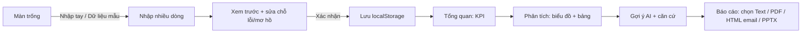

# C4a · Luồng người dùng và bộ lọc kỳ (Trịnh Khoa)

Trạng thái: **Đã hoàn thiện & kiểm thử E2E trên nhánh `codex/khoa-ux-report-polish`** (xem chi tiết tại [`docs/khoa/ux-report-polish-handoff.md`](./ux-report-polish-handoff.md)).

## 1. Luồng chính (người mới, không cần hướng dẫn)

Bước sửa/hoàn tác luôn có thể quay lại từ mọi màn hình. Ba tab Tổng quan/Phân tích/Báo cáo dùng **cùng một bộ lọc kỳ và cùng một snapshot**.

## 2. Bộ lọc kỳ (đề xuất)

| Lựa chọn | Ý nghĩa |
|---|---|
| Toàn bộ dữ liệu (mặc định) | từ ngày nhỏ nhất đến lớn nhất đã xác nhận |
| 7 ngày gần nhất / 30 ngày gần nhất | tính lùi từ ngày dữ liệu mới nhất, không phải ngày hôm nay |
| Tuỳ chọn từ–đến | người dùng chọn |
| Chiến dịch | chỉ hiện nếu C1 của Dũng có trường chiến dịch |

Quy tắc: kỳ luôn hiển thị dạng `dd/mm/yyyy – dd/mm/yyyy (N ngày, M ngày có dữ liệu)`. Ngày thiếu được ghi chú, **không** coi là 0.

## 3. Trạng thái màn hình

| Trạng thái | Hành vi |
|---|---|
| Trống | CTA "Nhập số liệu" + "Dùng dữ liệu mẫu" (có nhãn Dữ liệu mẫu) |
| Dữ liệu lỗi/thiếu | báo tại ô, sửa tại chỗ, KPI không tính được hiện "Không tính được" + lý do |
| Đang xử lý | tiến trình đọc file / chờ AI, có nút hủy, không chờ vô hạn |
| AI lỗi/chậm | KPI, biểu đồ, báo cáo vẫn dùng được; khung gợi ý hiện lỗi + nút thử lại; ghi rõ không phải AI |
| Dữ liệu đổi sau khi tạo báo cáo | xem `report-snapshot-contract.md` mục 3 |

## 4. Responsive (breakpoint sẽ chốt khi thiết kế Stitch)

- **Desktop**: thanh bên + bộ lọc trên cùng, bảng và 3 biểu đồ cạnh nhau.
- **Tablet**: thanh bên thu gọn, biểu đồ 1–2 cột.
- **Mobile**: tab dưới, KPI dạng thẻ dọc, biểu đồ cuộn ngang, nút Copy cố định cuối màn hình báo cáo.

Truy cập: focus bàn phím, nhãn cho nút, tăng/giảm có mũi tên + chữ chứ không chỉ màu.
